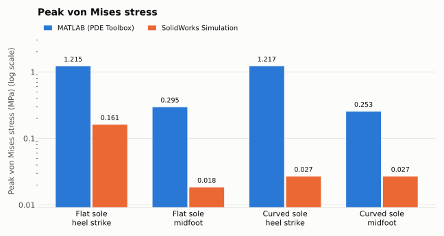
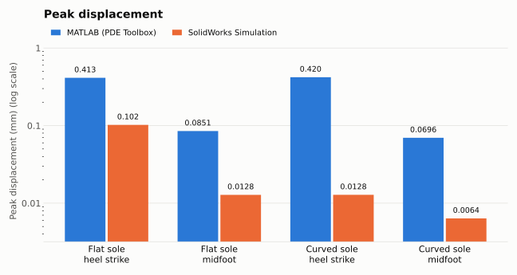

# Sneaker Sole Analysis

A static finite element analysis in MATLAB of two EVA sneaker soles (flat and curved), checked against SolidWorks Simulation.

The goal is to understand how a sneaker sole behaves under **normal walking conditions** with a heel-first landing and a midfoot landing. This is a static study, so it does not apply to running, which would need a dynamic analysis.

## Setup

| | |
|---|---|
| Material | EVA, linear elastic, E = 25 MPa, ν = 0.48 |
| Load | 1946 N, applied downward on the top surface |
| Heel strike | Load on a heel patch 6 cm from the back of the sole |
| Midfoot | Load spread over the whole top surface |
| Supports | Base and sides fixed |
| Mesh | Linear tetrahedra, **3 mm** max element size |

The 3 mm element size was chosen from a mesh convergence study with a 5% tolerance.

## Results

| Case | MATLAB stress (MPa) | SolidWorks stress (MPa) | MATLAB displacement (mm) | SolidWorks displacement (mm) |
|---|---:|---:|---:|---:|
| Flat, heel strike | 1.215 | 0.161 | 0.860 | 0.102 |
| Flat, midfoot | 0.295 | 0.018 | 0.177 | 0.0128 |
| Curved, heel strike | 1.217 | 0.027 | 0.876 | 0.0128 |
| Curved, midfoot | 0.253 | 0.027 | 0.145 | 0.0064 |





## Key takeaways

- **Heel strike is the worst case.** The same force on a smaller area gives about 4 to 5 times the stress and displacement of a midfoot landing.
- **Sole shape matters less than landing pattern.** The flat and curved soles are almost the same under heel strike. Under midfoot loading the curved sole is about 15% lower, because its larger top surface spreads the load.
- **MATLAB and SolidWorks agree on the trend but not on the size.** MATLAB's values are higher, likely because of differences in how each tool applies supports and defines the loaded region.

## Repository

```
matlab/     SoleFEM.m (main analysis), SoleFaces.m (find face numbers on an STL)
results/    MATLAB figures, SolidWorks images, Excel summary
docs/       README charts
```

To run: put the STL files next to `SoleFEM.m`, create a `Results_Figures` folder, and run the script in MATLAB with the PDE Toolbox.
